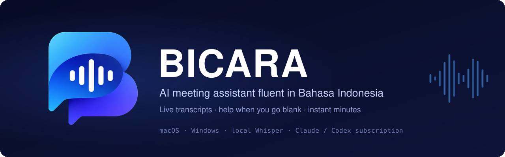

<p align="center">
  
</p>

<p align="center">
  <a href="https://github.com/nvr0x5/BICARA/releases/latest"></a>
  
  <a href="LICENSE"></a>
  
</p>

**BICARA** (*"speak"* in Indonesian) is a desktop assistant for meetings, interviews and webinars.
It listens to **one app** — Zoom, Google Meet in your browser, Teams — plus your microphone,
transcribes **locally**, and helps you in real time: suggesting an answer when you go blank,
summarising, proposing follow-up questions and translating live. When the meeting ends it writes
Indonesian-style minutes (*notulen*) you can export or share.

It is built for Indonesian conversations first (formal/casual register, Indonesian minutes, HR
interview pack, UU PDP consent reminder) and works in English too. The AI runs on **your own
Claude or ChatGPT/Codex subscription** through their official CLIs, or on any API key you bring.

## Features

| | |
|---|---|
| **Per-app audio capture** | Capture only the meeting app, not your whole system. Core Audio process taps on macOS, WASAPI process loopback on Windows. |
| **Local transcription** | whisper large-v3-turbo on your machine (Metal on Apple Silicon). Indonesian, English or automatic; text appears while people are still speaking. |
| **Help me answer** | Detects questions from the other side and suggests an answer, or press <kbd>⌘⇧J</kbd> / <kbd>Ctrl+Shift+J</kbd> any time. |
| **Live translation** | Every line translated Indonesian ↔ English, saved with the transcript. |
| **Context files** | Add PDF, Word, PowerPoint or text (agenda, CV, job description, proposal) before the meeting; answers use them. |
| **Presets** | Meeting, job interview (as candidate or interviewer), client call, webinar, sales — or write your own system prompt. |
| **Minutes & history** | Indonesian *notulen* after every meeting, full-text search across meetings, ask questions about a past meeting, export to Word / Markdown, share via WhatsApp. |
| **Stealth mode** | Windows are hidden from screen sharing and recordings; <kbd>⌘⇧H</kbd> hides everything instantly. |
| **Native app** | Sidebar, toolbar and menus that follow macOS and Windows conventions; light and dark; Indonesian or English interface. |

## Install

Download the latest build from **[Releases](https://github.com/nvr0x5/BICARA/releases/latest)**.

**macOS (Apple Silicon, macOS 14.2+)** — open the `.dmg` and drag BICARA to Applications.
The app is not notarized by Apple, so the first time macOS blocks it:
open **System Settings → Privacy & Security**, scroll down and click **Open Anyway** next to BICARA.
If macOS says the app *"is damaged and can't be opened"*, clear the download quarantine flag:

```bash
xattr -dr com.apple.quarantine /Applications/BICARA.app
```

On first use macOS asks for *System Audio Recording* and *Microphone* permission.

**Windows 10 (2004+) / 11** — run `BICARA_x.y.z_x64-setup.exe`.
The installer is not code-signed, so SmartScreen may warn: click **More info → Run anyway**.

### First run

1. **Settings → Transcription**: download the speech model (~574 MB, once).
2. **Settings → AI**: pick a provider and press **Test connection**.
   - **Claude subscription** (Pro/Max): install [Claude Code](https://docs.claude.com/en/docs/claude-code) and run `claude` once to log in.
   - **ChatGPT / Codex subscription** (free or paid): install the [Codex CLI](https://github.com/openai/codex) and run `codex login`.
   - **Anthropic API**, **OpenAI**, **Groq**, **OpenRouter**, or local **Ollama / LM Studio**: paste a key or a local URL.
3. **New meeting**: pick the meeting app (for Google Meet, pick your browser), add context files, start.

### Troubleshooting

BICARA writes a log file you can attach to a bug report (it contains technical steps, not transcripts).
Open it from **Settings → Privacy → Open logs folder**, or go to:

- **macOS:** `~/Library/Logs/id.bicara.desktop/bicara.log`
- **Windows:** `%LOCALAPPDATA%\id.bicara.desktop\logs\bicara.log`

## Privacy

- Audio and transcription stay on your computer. Recordings, transcripts and minutes are stored
  locally in a SQLite database; you can turn off keeping audio.
- Only **text** (transcript excerpts, your context files and questions) is sent, and only to the
  AI provider you choose, when you use an AI feature or live translation.
- BICARA never reads your Claude or ChatGPT tokens: it runs the official CLIs as your user.
  API keys are stored in the macOS Keychain / Windows Credential Manager.

## Responsible use

Tell people when you record and transcribe a conversation, and follow the law where you are —
in Indonesia that includes **UU PDP** (Law 27/2022 on personal data protection). BICARA reminds
you before each recording. Stealth mode hides the app from screen sharing; how you use it is your
responsibility, including respecting the rules of interviews and exams.

## Build from source

Requirements: Rust (stable), Node 20+ and pnpm, CMake; on macOS Xcode command-line tools; on
Windows the MSVC build tools and LLVM.

```bash
pnpm install
pnpm tauri dev                                   # run in development
pnpm tauri build                                 # release build (.app/.dmg or .exe/.msi)
pnpm tauri build --debug --bundles app           # quick macOS debug bundle
```

Tests: `cargo test --workspace` and `pnpm exec tsc --noEmit`.

### Project layout

| Path | What |
|---|---|
| `crates/bicara-audio` | Per-app capture (macOS Core Audio taps in `native/macos/tap.m`, Windows WASAPI loopback) and microphone |
| `crates/bicara-stt` | Resampler, voice-activity segmentation, whisper worker, live partial transcripts |
| `crates/bicara-llm` | Providers: Claude CLI, Codex CLI, Anthropic API, OpenAI-compatible; model listing and connection test |
| `crates/bicara-docs` | Text extraction (PDF, DOCX, PPTX) and chunking for context files |
| `src-tauri/src` | Capture sessions, assistant, meetings, SQLite store (FTS5), settings, menus, stealth |
| `src/` | React + TypeScript interface (Indonesian / English) |
| `tools/stt-eval` | Indonesian speech-to-text benchmark (WER/CER) |
| `docs/` | Brand assets and design previews ([macOS](docs/design-previews/native.html), [Windows](docs/design-previews/windows.html)) |

### Examples

```bash
cargo run -p bicara-audio --example list_apps                     # apps that can be captured
cargo run -p bicara-audio --example capture_app -- <app-id> 10 out.wav
REALTIME=1 cargo run --release -p bicara-stt --example transcribe -- <model.bin> <file.wav>
cargo run -p bicara-llm --example probe -- sonnet opus            # which model a Claude alias resolves to
```

## Status

BICARA is a personal project in active development. macOS is used daily; the Windows build
compiles and packages in CI but has had little real-world testing. See [PLAN.md](PLAN.md) for the
roadmap and per-phase status.

## License

[MIT](LICENSE)
